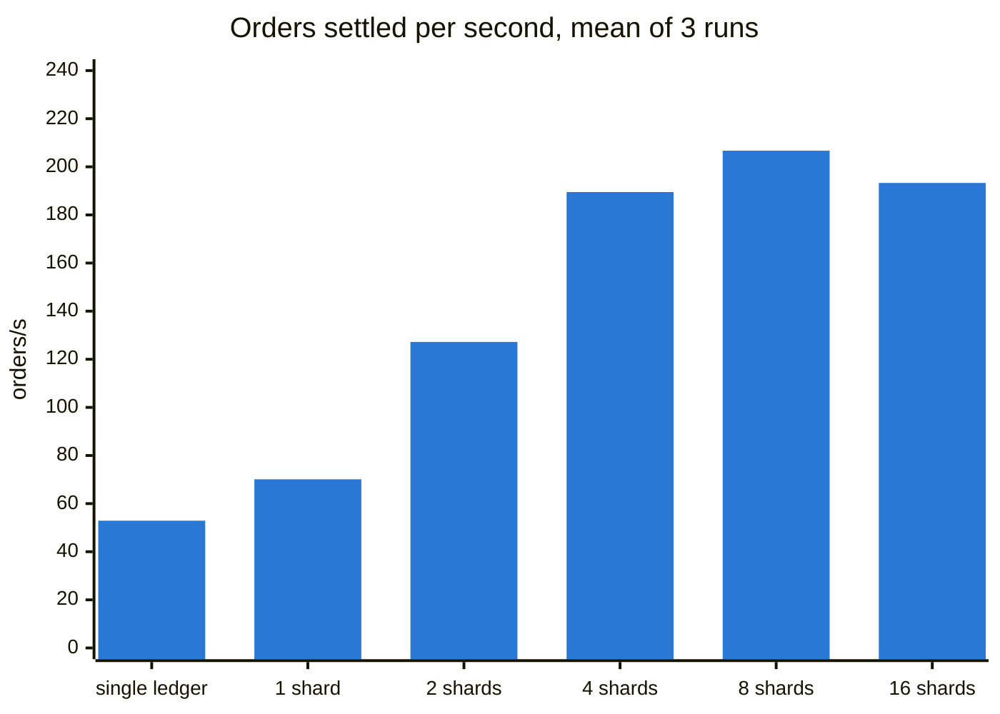
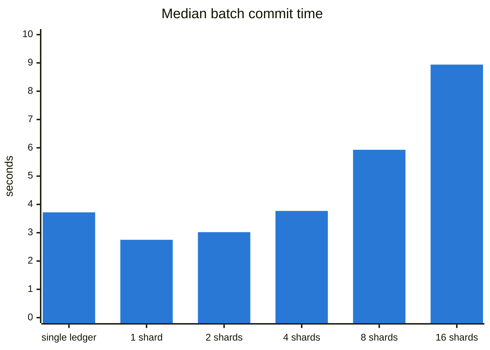
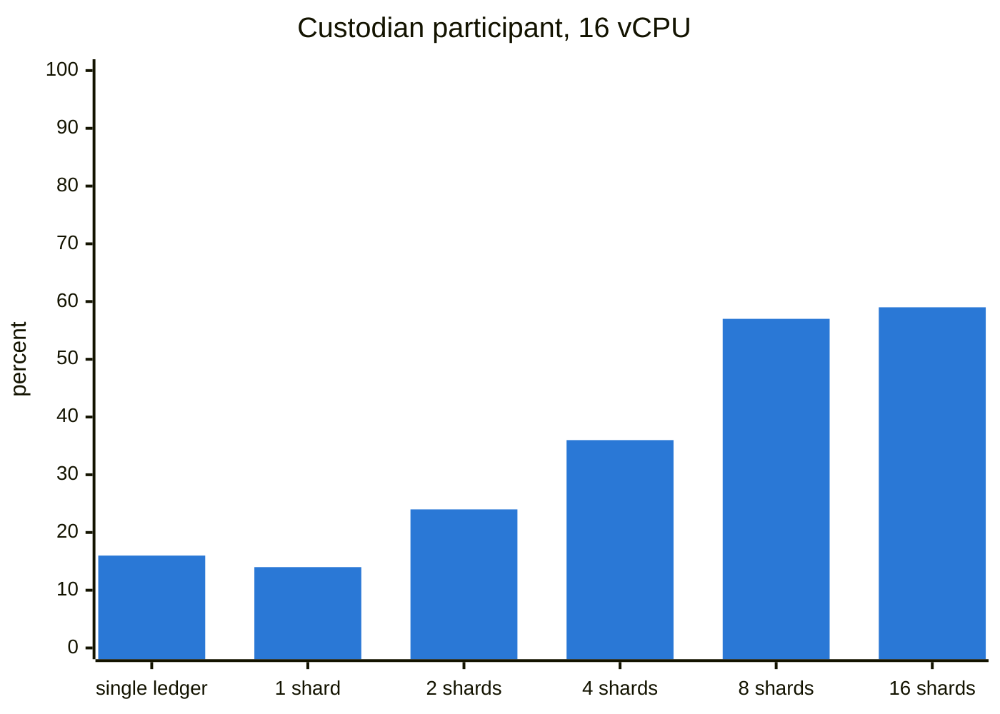
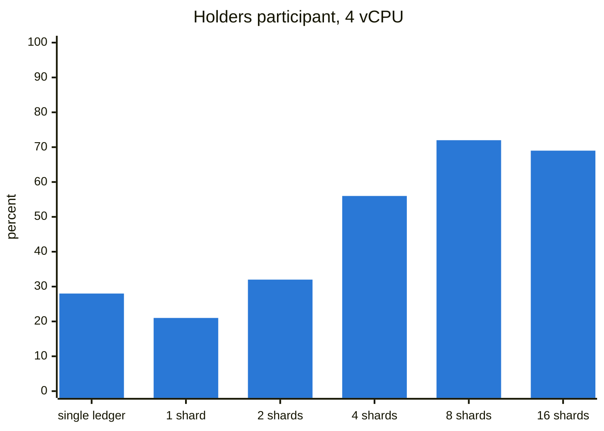
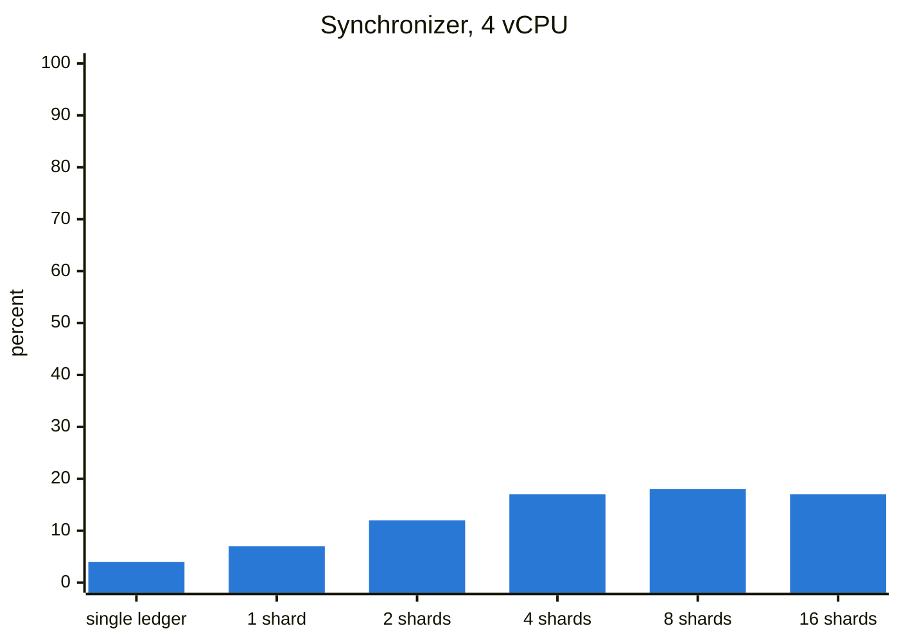

# Cluster benchmark results

How fast the sharded batched vault and the single-ledger batched vault settle a backlog of orders on a three-node Canton network. Measured on 4 November 2026.

## Summary

1. The sharded vault with 8 shards settled **206.7 orders a second**, **3.9 times** the single-ledger batched vault's 52.9, on the same network and workload.
2. Netting alone gives 1.33 times. With one shard, the sharded vault settles a batch with one settlement per token registry instead of two per order, and reached 70.1 orders a second.
3. Running batches in parallel multiplies that by about 3. Throughput nearly doubled from 1 to 2 shards and kept rising to 8.
4. Beyond 8 shards it stopped. The limit was not the vault or the custodian: the 4 vCPU participant hosting the holders ran at 100 percent, because it confirms the holders' side of every batch. The 16 vCPU custodian participant still had headroom.
5. Every one of the 18 runs ended with the book exactly matching the real token holdings.

## Setup

### Network

| VM | Machine | Runs |
|---|---|---|
| `vault-sync` | n2-standard-4, 4 vCPU, 16 GB | BFT sequencer and mediator, plus the benchmark driver |
| `vault-custodian` | c2d-standard-16, 16 vCPU, 64 GB | Participant hosting the custodian, the batcher, the token registrar and the sponsor |
| `vault-holders` | n2-standard-4, 4 vCPU, 16 GB | Participant hosting 40 holders |

1. Google Cloud, zone `us-east1-b`, all three VMs on one internal network.
2. Canton open source 3.5.15, Daml-LF 2.1, Java 21. Every node stores its data in its own local Postgres 16.
3. Participant heap 40 GB on the custodian, 8 GB elsewhere. No other Canton tuning.
4. The vault packages, token and tests are the ones in this repository at the time of the run.

Before the benchmark, `check.py` confirmed that this was a real cluster: two participants with different ids, a holder party known to the custodian participant as remote, and a holding signed by parties on both participants committed through the remote synchronizer.

### Workload

Each run starts from scratch with fresh parties, fresh token registries and a fresh vault.

1. **Setup, not timed.** The registrar funds 40 holders with 400 USD each through mint offers they accept from their own participant. Every holder deposits 100 USD. The sponsor tops up the vault by 10 percent, so the price is 1.1 USD per share, not 1.
2. **Backlog, not timed.** The holders place 4,000 orders from their participant in parallel, half deposits of 1 USD and half redemptions of 0.5 vUSD. Each order is two transactions: a committed allocation, then the order. Holders see the vault and token contracts through explicit disclosure.
3. **Settlement, timed.** From the first batch submission to the last completion, with the whole backlog already visible to the custodian.
   1. Single-ledger batched vault: one batcher runs batches of up to 200 orders back to back.
   2. Sharded batched vault: K batcher workers, one per shard, each running batches of up to 200 orders on its own shard at the same time. Orders go to shard `hash(order contract id) mod K`.
4. **Fold, timed separately** for the sharded vault: one fold of all shards after the backlog is settled.
5. **Balance check.** Reserve holdings must equal the accounted assets, and all share holdings, locked or not, must equal the issued shares.

Each configuration ran 3 times, interleaved: batched, then K = 1, 2, 4, 8 and 16, then the same again twice.

## Throughput

| Configuration | Orders/s mean | min | max | vs batched | vs one shard |
|---|---:|---:|---:|---:|---:|
| Batched | 52.9 | 48.6 | 55.5 | 1.00 | |
| Sharded, K = 1 | 70.1 | 60.6 | 76.9 | 1.33 | 1.00 |
| Sharded, K = 2 | 127.2 | 122.0 | 137.2 | 2.40 | 1.81 |
| Sharded, K = 4 | 189.5 | 177.3 | 199.5 | 3.58 | 2.70 |
| Sharded, K = 8 | **206.7** | 194.2 | 220.3 | **3.91** | 2.95 |
| Sharded, K = 16 | 193.3 | 186.5 | 199.7 | 3.65 | 2.76 |

Settling the 4,000-order backlog took 76 seconds on average with the single-ledger vault and 19 seconds with 8 shards.



## Batches

| Configuration | Batches per run | Commit median s | p95 s | max s | Fold s |
|---|---:|---:|---:|---:|---:|
| Batched | 20 | 3.72 | 4.30 | 4.42 | |
| Sharded, K = 1 | 20 | 2.75 | 3.48 | 3.51 | 0.42 |
| Sharded, K = 2 | 21 | 3.02 | 3.52 | 4.08 | 0.42 |
| Sharded, K = 4 | 22 | 3.77 | 4.86 | 5.46 | 0.40 |
| Sharded, K = 8 | 24 | 5.93 | 10.21 | 10.94 | 0.48 |
| Sharded, K = 16 | 32 | 8.94 | 16.93 | 18.22 | 0.52 |

1. With one shard, a netted batch of 200 orders commits in 2.75 seconds against 3.72 for the single-ledger vault, which settles every order separately.
2. As shards are added, each batch takes longer because the batches compete for the same CPUs. Up to 8 shards the extra parallelism more than makes up for it.
3. More shards also means more, smaller batches: 4,000 orders split 16 ways leave many batches well under 200 orders.
4. A fold of all shards took under 0.6 seconds at every size tested.



## CPU

Mean and peak CPU use during settlement, averaged over the three runs of each configuration, from `vmstat` sampled every 5 seconds.

| Configuration | Custodian, 16 vCPU | Holders, 4 vCPU | Synchronizer, 4 vCPU |
|---|---:|---:|---:|
| Batched | 16 / 28 | 28 / 39 | 4 / 20 |
| Sharded, K = 1 | 14 / 26 | 21 / 32 | 7 / 15 |
| Sharded, K = 2 | 24 / 32 | 32 / 49 | 12 / 19 |
| Sharded, K = 4 | 36 / 49 | 56 / 80 | 17 / 22 |
| Sharded, K = 8 | 57 / 73 | **72 / 100** | 18 / 25 |
| Sharded, K = 16 | 59 / 93 | **69 / 100** | 17 / 31 |

1. The single-ledger vault leaves every node mostly idle. It is limited by doing one batch at a time, not by hardware.
2. From 8 shards on, the holders participant reaches 100 percent. Every batch creates the holders' receipt allocations and moves their shares and USD, so that participant confirms part of every transaction. With 4 vCPU it is the first thing to saturate.
3. The custodian participant averages under 60 percent even at 16 shards, and the synchronizer stays under 35 percent. Neither is the limit here.

Mean CPU busy percent during settlement, one chart per node, same scale:





## Placement

Order placement ran at 32 to 38 orders a second in every run, about 72 transactions a second on average, because each order is two transactions. Placement does not touch the vault's book, so it does not contend with settlement. In these runs it was measured separately and is not part of the throughput above.

## Single sandbox, for comparison

The same comparison on one local Canton sandbox, all parties on one participant, in a container limited to 2 CPU cores: 2,000 orders, batches of 200, one run each.

| Configuration | Orders/s | vs batched |
|---|---:|---:|
| Batched | 31.5 | 1.00 |
| Sharded, K = 1 | 55.7 | 1.77 |
| Sharded, K = 2 | 75.3 | 2.39 |
| Sharded, K = 4 | 83.6 | 2.65 |
| Sharded, K = 8 | 77.1 | 2.45 |

The pattern is the same, with the ceiling reached earlier: two cores are full by 4 shards.

## What this means

1. Netting is worth having on its own. Even with one shard, settling a batch in one call per registry beats settling each order separately.
2. Sharding scales with the hardware of every participant that confirms the batches, not just the custodian's. Here the holders' participant was the ceiling. A vault whose holders are spread over many participants, as on a real network, spreads that confirmation load too.
3. The batch size of 200 was chosen in earlier single-sandbox tests and was not tuned for the cluster. With more shards, smaller per-shard backlogs lead to more, smaller batches.

## Limits of this test

1. One holders participant. Real holders would sit on many participants, each confirming only its own holders' part of a batch.
2. One zone, so network latency between nodes is low.
3. Placement and settlement were measured separately. A live system does both at once.
4. Folds were timed but not run during the timed window. A fold consumes every shard, so a live batcher has to pause the shard workers while it runs.
5. Three runs per configuration. The fastest and slowest run of one configuration differ by 7 to 27 percent, most at K = 1.

## Next

1. Give the holders participant 8 vCPU (`gcp/resize.sh`) and rerun K = 4, 8, 16 and 32, to see how far the custodian can go.
2. Split the holders over two or more participants.
3. Tune the batch size per shard count.

## Reproduce

See [README.md](README.md). Raw data for these runs is in [`results/20261104T075526Z/`](results/20261104T075526Z): `runs.jsonl` (one line per run, with every batch commit time), `bench.log` (driver log) and one `vmstat` log per VM. `report.py` rebuilds the tables above from it.

```sh
python3 vault/cluster/report.py vault/cluster/results/20261104T075526Z/runs.jsonl \
  --vmstat-dir vault/cluster/results/20261104T075526Z
```

The cluster ran for 6 hours in total, setup included, at an estimated 7 USD in on-demand compute.
