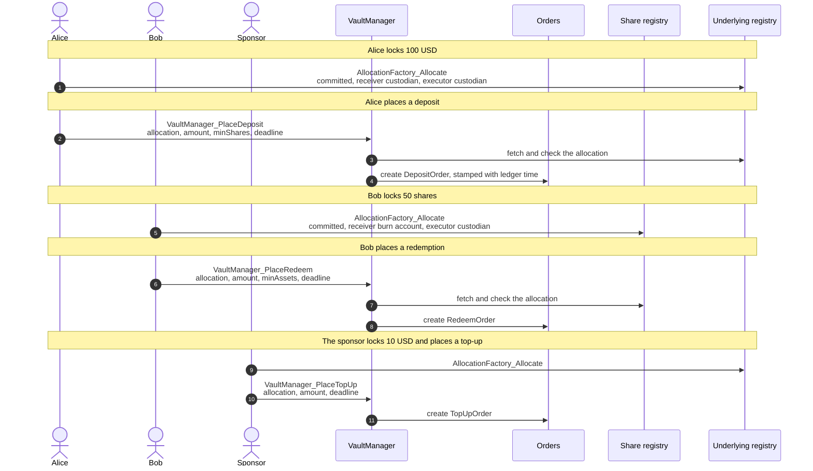
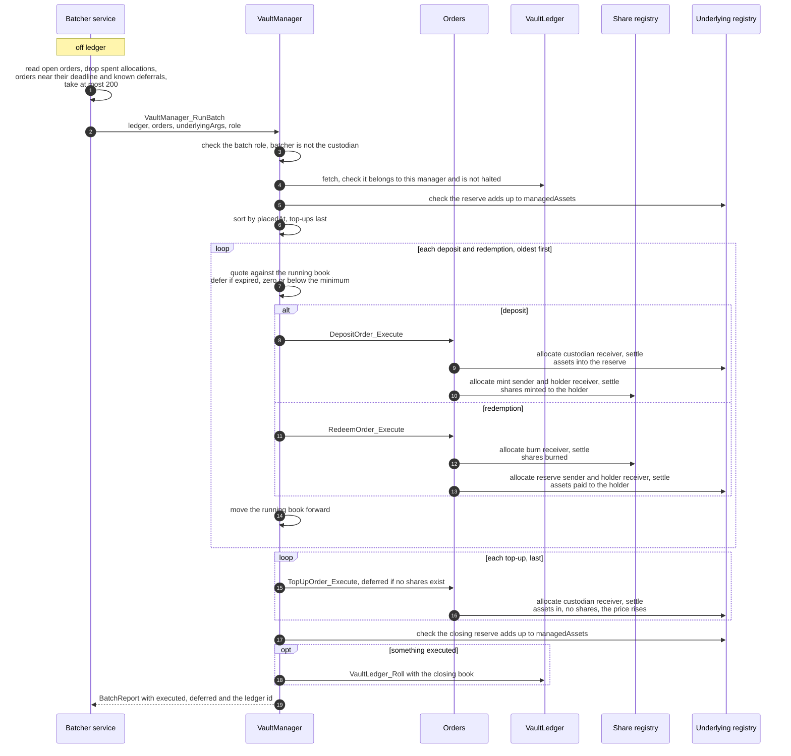
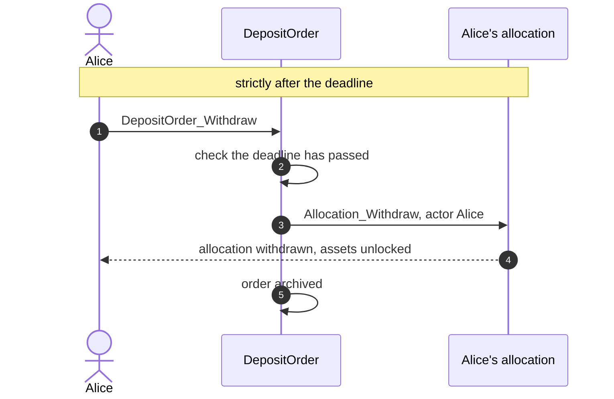

# Vault flows

This page describes the single-ledger batched vault in `packages/vault`, with one book contract. The sharded batched vault in `packages/vault-sharded` uses the same orders, roles and rules, and splits the book into shards, see [sharding.md](sharding.md).

The vault holds one CIP-0112 asset and issues CIP-0112 shares against it. Holders place orders, and a batcher executes many orders in one transaction. The share price is `managedAssets / issuedShares`, kept on ledger in `VaultLedger`, so the ledger computes every output and nobody off ledger supplies a price.

## Contracts

| Contract | Signed by | What it does |
|---|---|---|
| `VaultManager` | custodian | Fixed terms. Accepts orders and runs batches, halts and resumes. Never replaced. |
| `VaultLedger` | custodian | The book (`managedAssets`, `issuedShares`, `reserve`) and the halt flag. Replaced once per batch that executes something, and on halt or resume. |
| `DepositOrder` | custodian, holder | Assets in, at least `minShares` out, before `deadline`. |
| `RedeemOrder` | custodian, holder | Shares in, at least `minAssets` out, before `deadline`. |
| `TopUpOrder` | custodian, sponsor | Assets in, nothing out. Raises the price. |
| Allocation | token admin, owner | CIP-0112 allocation behind each order. Locks the input and names the custodian as executor. |
| Share registry | custodian | `TokenRules` from `packages/token`, a small CIP-0112 token. Shares are minted from and burned to the standard mint and burn accounts. |
| Underlying registry | token admin | Any CIP-0112 registry. The vault only calls its interfaces. The tests use a second `TokenRules`. |
| `VaultRole` | custodian | One permission (`batch`, `halt` or `resume`) for one party on one vault. Revoked by the custodian or renounced by the holder. |

Roles:

1. **Custodian.** Holds the reserve and administers the shares. Signs the manager and the ledger.
2. **Holder.** Places deposit and redeem orders, and withdraws them after the deadline.
3. **Sponsor.** The only party that can top up the reserve.
4. **Batcher.** Runs batches with a `batch` role from the custodian. Cannot be the custodian.
5. **Warden.** Halts and resumes with `halt` and `resume` roles.

## Placing orders

Each order takes two transactions by the holder. First a committed, non-iterated allocation that locks the input, then the order that points to it. Placing an order does not touch `VaultLedger`, so orders never contend with batches.

## Running a batch

The batcher reads open orders off ledger and submits one `VaultManager_RunBatch`. The ledger sorts the orders, prices each one against the running book and settles it, all in one atomic transaction.

Notes:

1. **Running totals.** Each order is priced against the book left by the order before it, so a batch gives exactly the same result as executing the orders one by one. Pricing everyone at the opening price would let later orders gain from rounding at the expense of existing holders.
2. **Rounding.** Deposits round shares down and redemptions round assets down, so dust stays in the vault. The first deposit into an empty vault gets one share per asset.
3. **Donations do not count.** Only holdings in `reserve` back the shares. Tokens sent straight to the custodian are ignored, so nobody can move the price by sending tokens.
4. **Deferral is not failure.** An order that is expired, would get nothing or would miss its minimum stays open for a later batch. Anything else that goes wrong fails the whole batch, and nothing changes.
5. **No netting.** Each executed order settles its own legs. A deposit of 100 and a redemption of 60 in one batch move 100 in and 60 out.

## Expiry

The same for all three order types. Shown for a deposit.

1. An order executes strictly before its deadline and is withdrawn strictly after it. At the deadline itself neither works.
2. The deadline must be within `orderLifetime` of placing, and within the allocation's own deadline and expiry. Deadlines are refused, never shortened.
3. If the allocation is already gone, for example withdrawn directly, `DepositOrder_Abandon` closes the order without touching it.
4. Halting the vault stops batches only. Holders can still place and withdraw orders.

## Batcher service

`batcher/service.py` is the reference batcher. The ledger enforces price, order, minimums and deadlines. The batcher only decides which orders go in and when.

1. It only picks orders whose allocation is still active, and only the oldest order per allocation.
2. It leaves out orders within 60 seconds of their deadline, so a withdrawal cannot race the batch.
3. It caps a batch at 200 orders.
4. It remembers orders a batch deferred and skips them until the ledger changes.
5. On a contention or missing-contract error it re-reads the ledger and retries with the orders still open.
6. It writes every submission to a journal first. A timeout is an unknown outcome, so it is reconciled from the completion stream before anything new is sent.
