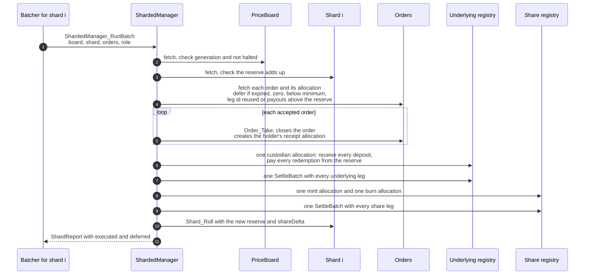
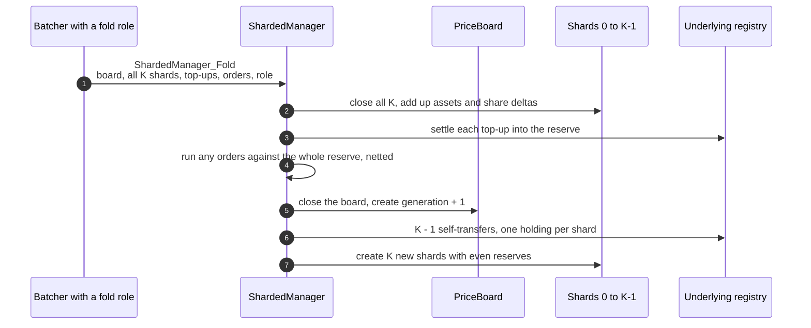

# Sharded batched vault

## Why

In the single-ledger batched vault every batch consumes the one `VaultLedger`, so batches run one after another. Throughput is one batch's size divided by its commit time, and on a local sandbox that was about 20 orders a second at 200 orders per batch. Most of that time is interpreting the batch, not contention. Every order ran two settlements of its own, so a 200-order batch made over a thousand factory calls.

The sharded vault attacks both costs.

1. **Sharding.** The book is split into `K` shard contracts. A batch consumes one shard, so `K` batchers can commit at the same time.
2. **Netting.** A batch settles all its orders with one CIP-0112 settlement per token registry, instead of two per order.

## One price for every shard

Shares are fungible, so all shards must use the same price. If shard prices drifted apart, a deposit on a cheap shard would dilute every holder. So shards do not price from their own totals. They all read one `PriceBoard`.

1. `PriceBoard` holds `managedAssets`, `issuedShares`, a `generation` and the halt flag. Batches fetch it and never consume it, so any number of batches can read it at once.
2. Each `Shard` holds its index, its generation, its reserve holdings and their sum (`assets`), and `shareDelta`, the shares minted minus burned on it since the last fold.
3. A batch on shard `i` prices every order at the board price, with rounding in the vault's favour, and replaces only shard `i`. Inside a generation every order gets the same price, whichever shard runs it and wherever it sits in the batch.
4. A **fold** consumes the board and all `K` shards. It adds them up, executes pending top-ups, optionally executes orders against the whole reserve, writes the next board, and splits the reserve into `K` equal holdings with self-transfers on the underlying registry, one per new shard.

The totals are still on ledger and the ledger still computes every price. The price is the board's, refreshed at each fold.

## Netting

Every order allocation names the same settlement: executor the custodian, id `canton-solutions/vault`, and the manager's contract id. That lets one batch settle together.

## Rules

1. **Genesis.** A board with no shares prices deposits one to one.
2. **Deposits:** `shares = floor(assets * issuedShares / managedAssets)` at the board price. **Redemptions:** `assets = floor(shares * managedAssets / issuedShares)`, paid from the shard's reserve. Payouts in one batch may not exceed the shard's reserve, the rest are deferred.
3. **Leg ids.** Holders pick their leg id. It must be unique within a batch and may not start with `vault/`, which the vault uses for the legs it creates. A reused id is deferred, so nobody can break a batch by copying another order's id.
4. **Top-ups only in a fold**, so the price rises for every shard at the same moment.
5. **Large redemptions.** A redemption bigger than one shard's reserve waits for a fold, which can execute it against the whole reserve. The last holder leaves the same way.
6. **Generation check.** A batch needs `shard.generation == board.generation`. A fold that lands first makes in-flight batches fail on a missing contract, and they retry on the new board and shards.
7. **Halt** replaces the board with the flag set. Every shard and every fold stops at once.

## Reading the book

Sharding changes how the book is read, not only how it is written. Shards are replaced by every batch, so under load there is no moment when all K shards stay still.

1. **Read off ledger, at an offset.** A participant serves its active contracts as of a ledger offset, and that offset is a consistent cut across every contract. A reader asks for the state at one offset and gets the board and all K shards exactly as they were then, whatever has landed since. Summing them gives the exact book at that offset. This never fails and never blocks a batch. It is the path for wallets, dashboards, audits and the balance check in the benchmark.
2. **Do not read all shards on ledger.** A Daml choice has no offsets. It binds to the shard contract ids it fetched when the transaction was prepared, and under load one of them is archived before the transaction is confirmed, so the transaction fails. Contract keys do not help, they resolve to a contract id at preparation and the same race follows.
3. **The board is the on-ledger read.** Batches fetch the price board without consuming it, so any number of them read it at once. The price it holds is exact as of the last fold.
4. **The fold is the one deliberate pause.** It is the only transaction that touches every shard, and it only succeeds because the batchers stop replacing shards while it runs. It took under 0.6 seconds at 16 shards in the benchmark. How often to fold is a policy choice: often for a fresher price, rarely for fewer pauses.
5. **Rules that need the exact live total move to the fold**, or are split per shard. Top-ups, redemptions too big for one shard and the last exit already run in the fold. A hard cap on assets under management, or anything else checked against the whole book per order, would have to be enforced at fold time or as K separate caps.

So writes scale with the number of shards, and anything that must read every shard on ledger either waits for a fold or must not exist.

## Costs and limits

1. **Price lag.** Inside a generation the price ignores rounding dust earned since the last fold. Dust only grows in the vault's favour, by at most a tick per order, so a depositor late in a generation can gain at most that dust.
2. **Top-up timing.** Deposits placed during a generation get the pre-top-up price, as in the single-ledger vault, where a deposit before a top-up batch does the same.
3. **Folds stop the world.** A fold consumes every shard, so batchers should pause while it runs or it keeps losing to them. How often to fold is a policy choice.
4. **Dust after a full exit.** If every share is redeemed, rounding dust can stay in the reserve, and the next depositor gets it. It is a few ticks.

## Measured

On a three-node Canton network on Google Cloud (synchronizer, a 16 vCPU custodian participant and a 4 vCPU holders participant, Postgres everywhere), 4,000 orders per run, batches of 200, three runs each:

| Version | Shards | Orders/s | vs batched |
|---|---:|---:|---:|
| Single-ledger batched vault | 1 | 52.9 | 1.00 |
| Sharded, netted | 1 | 70.1 | 1.33 |
| Sharded, netted | 2 | 127.2 | 2.40 |
| Sharded, netted | 4 | 189.5 | 3.58 |
| Sharded, netted | 8 | 206.7 | 3.91 |
| Sharded, netted | 16 | 193.3 | 3.65 |

Past 8 shards the holders participant was at 100 percent CPU, so that participant, not the vault, set the ceiling. Full method, batch times, CPU per node and raw data are in [../cluster/RESULTS.md](../cluster/RESULTS.md).
